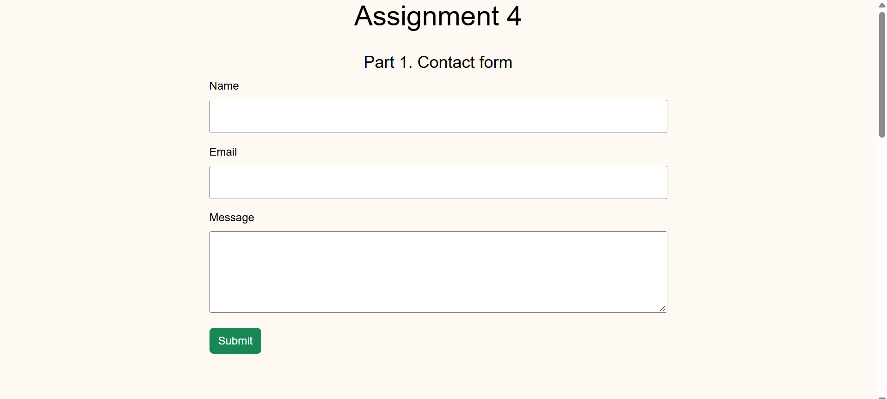
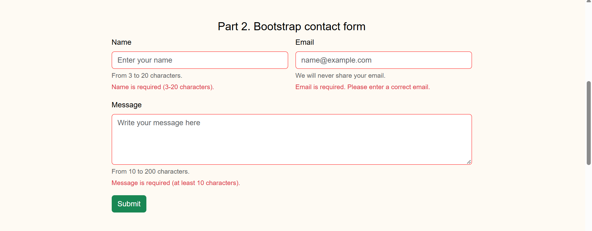
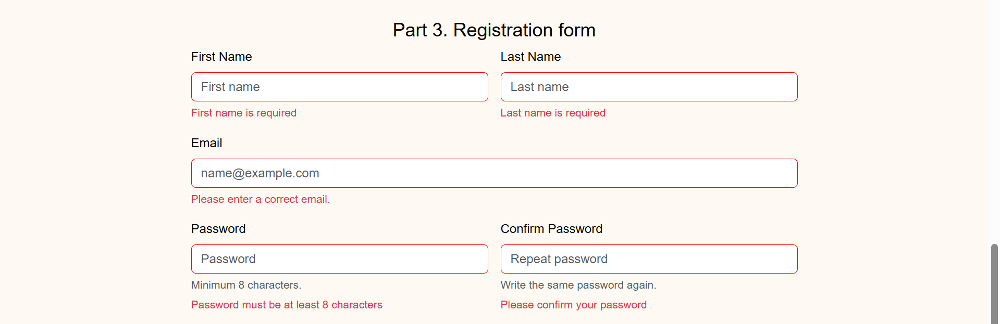
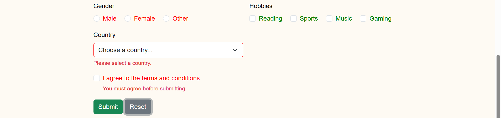

# Assignment 4. Forms and Validation

Name: Gulim Zhumabay

Group: SE-2539

## Overview

This project is a web page with forms for Assignment 4. The goal was to practice making forms with HTML, styling them with Bootstrap, and adding validation. The page has three parts, and each part has one form.

## Part 1. Basic HTML Forms

Task 0. Created a contact form with a name field, an email field, a message field and a submit button. Every field has its own label that is connected to the input with for and id.

Task 1. Added HTML5 validation attributes. All fields have required. The name has minlength 3 and maxlength 20. The email has type email, so the browser checks that it has @. The message has minlength 10 and maxlength 200. I tested it by leaving the fields empty and by writing a wrong email, and the browser showed an error message and did not send the form.

## Part 2. Bootstrap Forms

Task 2. Made the contact form with Bootstrap classes like form-control, form-label and btn. Used the Bootstrap grid, so the name and email are in two columns on a big screen and in one column on a phone. Added placeholders and small helper text under the fields.

Task 3. Added validation feedback messages under the inputs. When a field is empty or wrong, the border is red and the message is shown, for example "Email is required". When the data is correct, the border is green and the message "Looks good" is shown. I tested it with correct and wrong data.

## Part 3. Advanced Form Project

Task 4. Made a registration form with first name, last name, email, password, confirm password, gender, hobbies, country, and submit and reset buttons. For HTML5 validation the password has minlength 8, the email has type email, and the other fields have required. The feedback messages work the same way as in Part 2: red error messages at the start and green "Looks good" when the data is correct. The reset button clears all fields.

## Work Process Summary

I started with the simple contact form in Part 1 and learned the validation attributes required, minlength, maxlength and type. Then in Part 2 I used the Bootstrap form classes and the grid with row and col-md-6. I also made the validation messages with CSS. The browser checks the HTML5 rules by itself, and in the CSS I used the :invalid and :valid selectors to change the border color. I also used the ~ selector to show the invalid-feedback and valid-feedback messages under the field. In the last part I put everything together in one registration form.